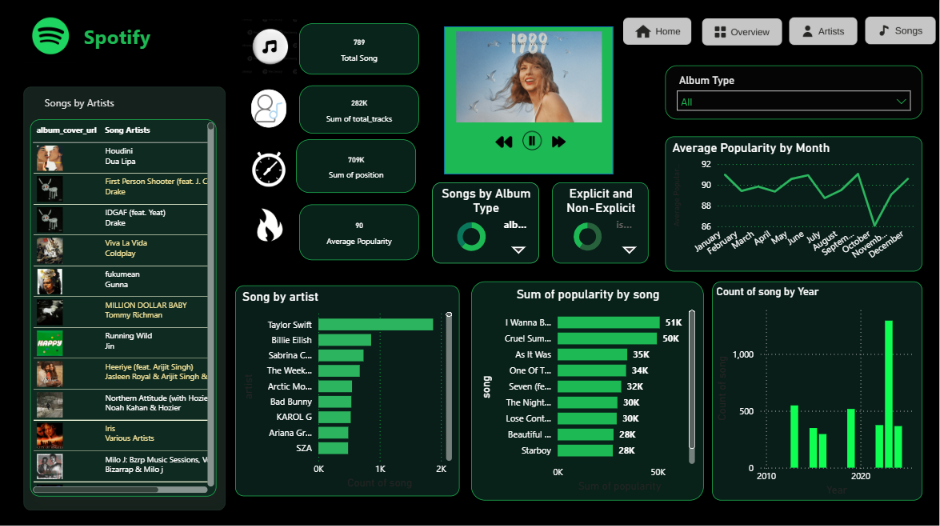
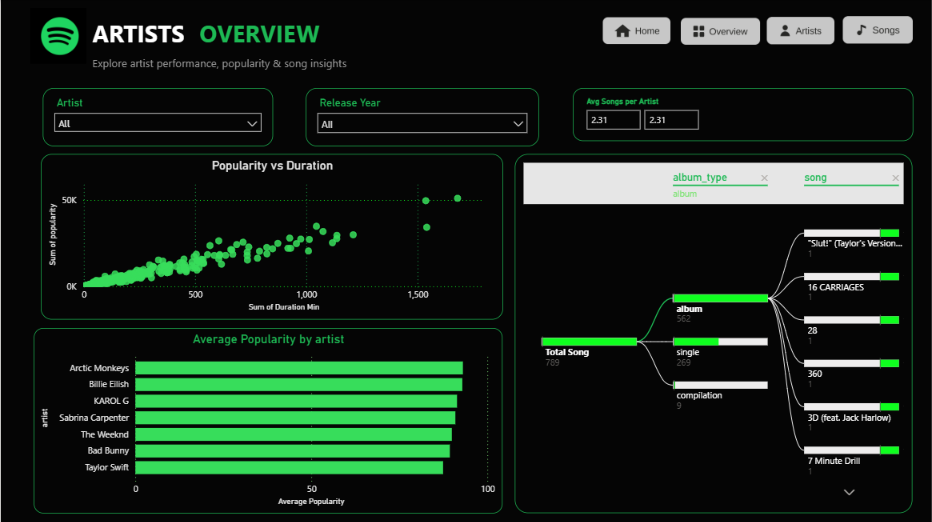

# 🎧 Spotify Top 50 World – Power BI Dashboard

An interactive, Spotify-themed Power BI dashboard that explores the **Spotify Top 50 World** chart: which songs and artists dominate, how popularity changes over time, and how song length, release decade and album type relate to success.


---

## 📌 Project Overview

The dashboard turns raw Spotify chart data into a clean, four-page report with a dark (black + Spotify green) design and button-based navigation. It is built to answer questions such as:

- Which artists have the most songs on the chart?
- Which songs have the highest total popularity?
- Does a longer song mean a more (or less) popular song?
- Which decades and album types do chart songs come from?
- How does average popularity change month by month?

---

## 📊 Dashboard Pages

### 1. 🏠 Home (Index)
Landing page with the Spotify logo, an album-cover collage and navigation buttons: **Home · Overview · Artists · Songs**.

### 2. 🧭 Overview


- **KPI cards:** Total Songs (789), Sum of Total Tracks, Sum of Position, Average Popularity (90)
- **Songs by Artists** list with album covers
- **Album Type** slicer
- **Songs by Album Type** and **Explicit vs Non-Explicit** donut charts
- **Average Popularity by Month** line chart
- **Song by Artist**, **Sum of Popularity by Song** and **Count of Songs by Year** bar charts

### 3. 🎤 Artists


- **Artist** and **Release Year** slicers
- **Avg Songs per Artist** card (2.31)
- **Popularity vs Duration** scatter plot
- **Average Popularity by Artist** bar chart
- **Decomposition tree:** Total Songs → Album Type → Album → Song

### 4. 🎵 Songs


- **Popularity** range slicer (0–100)
- **Longest Song** (7:36) and **Shortest Song** (0:41) cards
- **Songs vs Release Decade** bar chart
- **Song Details** table
- **Total Songs and Average Popularity by Artist** scatter plot
- **Songs by Duration** (Under 2, 2 to 3, 3 to 4, Over 4 minutes)

---

## 🗂️ Dataset

**Table:** `spotify-top-50-world`

| Column | Description |
|---|---|
| `album_cover_url` | Link to the album cover image |
| `album_type` | Album, single or compilation |
| `artist` | Artist name(s) |
| `date` | Chart date |
| `duration_ms` | Song length in milliseconds |
| `is_explicit` | Whether the song is explicit |
| `popularity` | Spotify popularity score (0–100) |
| `position` | Chart position |
| `release_date` | Release date of the song/album |
| `song` | Song title |
| `total_tracks` | Number of tracks on the album |

---

## 🧮 DAX Measures & Calculated Columns

Measures used in the report include:

- **Total Songs** – count of songs
- **Total Artists** – count of distinct artists
- **Average Duration** – average song length
- **Average Popularity** – average popularity score
- **Avg Songs per Artist** – songs divided by artists
- Calculated columns such as **Duration (Min)**, **Duration Bin**, **Release Year** and **Release Decade**

> Example:
> ```DAX
> Average Popularity = AVERAGE('spotify-top-50-world'[popularity])
> Duration Min = 'spotify-top-50-world'[duration_ms] / 60000
> Release Decade = FLOOR(YEAR('spotify-top-50-world'[release_date]), 10) & "s"
> ```

---

## 🔍 Key Insights

- **Taylor Swift** has by far the most songs in the dataset, followed by Billie Eilish and Sabrina Carpenter.
- **Arctic Monkeys, Billie Eilish and KAROL G** lead on average popularity.
- Most songs (around **700 of 789**) were released in the **2020s**.
- The **3–4 minute** range is the most common song length.
- Popularity generally rises with total duration across artists, with a few extreme outliers.
- About **562** tracks come from albums and **269** are singles.

---

## 🎨 Design

- **Background:** Black `#050505`
- **Accent:** Spotify green
- **Navigation buttons:** Rounded rectangles in light grey `#E6E6E6` with icons
- **Visuals:** Rounded green-bordered containers for a consistent look

---

## 🛠️ Tools Used

- **Power BI Desktop** – data modelling, DAX and visuals
- **Excel / CSV** – data source
- **DAX** – measures and calculated columns

---

## 🚀 How to Use

1. Clone or download this repository.
2. Open `Spotify Dashboard.pbix` in **Power BI Desktop**.
3. If prompted, refresh the data or point it to the dataset file in the `data/` folder.
4. Use the navigation buttons at the top to move between pages, and the slicers to filter.

---

## 📁 Repository Structure

```
├── Spotify Dashboard.pbix
├── data/
│   └── spotify-top-50-world.csv
├── images/
│   ├── home.png
│   ├── overview.png
│   ├── artists.png
│   └── songs.png
└── README.md
```

---

## 👤 Author

**Sakshi**
💻 [GitHub](https://github.com/sakshiy0456-sudo/Spotify-Dashboard)

---

⭐ If you like this project, please give it a star!
